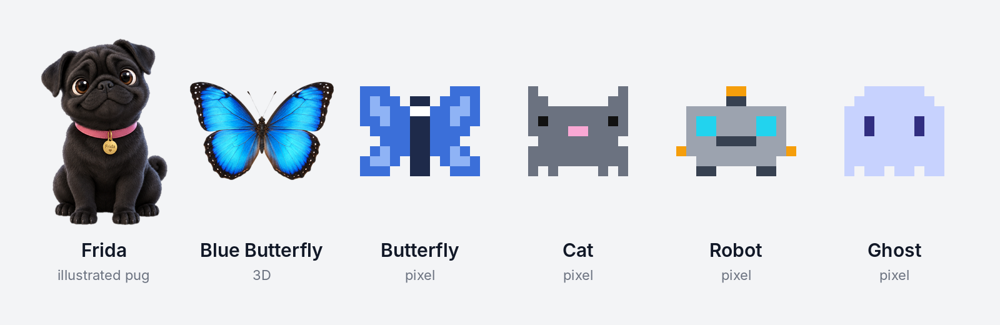

# Mascote Flutuante (Floating Mascot for Claude Code)

[Português](README.md) · **English**

A small character that sits in a corner of your screen, on top of your other windows, and shows what Claude is doing while you work in another app.



| Balloon | Color | When |
|---|---|---|
| Working | blue | Claude is running a request |
| Needs you | yellow | Claude stopped, waiting for a permission or an answer |
| Ready for review | green | Claude finished |
| Something is stuck | red | the conversation stopped with an error |

The mascot's texts (balloons, menus, character names) follow your computer's language: Portuguese on a Portuguese system, English otherwise. To switch, right-click the mascot > Idioma / Language. Where this page quotes a menu label in Portuguese, the English menu shows its translation.

## What it does

- Click the mascot: go straight to the conversation that is calling you (first the ones that need you, then the stuck and the finished ones). Click again: go to the next one. With none calling, it opens Claude.
- Click the number beside it: a list of your conversations, with the title, the status of each one and the start of the last request. Clicking a conversation opens it in the Claude app (Code tab). Terminal conversations just open Claude.
- Right-click: a menu with quick chat, mini mode, cursor following, character and quit.
- Quick chat: a rounded bar below the mascot ("Iniciar novo chat"). It opens with a double-click on the mascot or with Ctrl+Alt+Space (on Mac, Control+Option+Space), from any app. Answers appear in balloons on a card above the mascot, and the conversation continues from one question to the next. The "+" starts a new conversation; Esc closes it.
- The eyes follow your mouse cursor; when you click anywhere, the pixel characters jump and the photo characters smile; it says "Hi!" ("Oi!" in Portuguese) when the cursor passes over it.
- Cursor following (Seguir o cursor): it walks after your mouse across the screen.
- Mini mode (Modo mini): it gets small, showing only the colored number.
- Sound alert: a discreet system sound when a conversation needs you or finishes. In the conversation list, each one shows "Som ligado" (sound on) or "Sem som" (muted): click to choose for that conversation only. The menu option "Aviso sonoro (padrão das conversas)" applies to the conversations you have not adjusted. In "Som do aviso", in the menu, you choose the sound; when you pick one, it plays so you can hear it. In "Meu arquivo de som", use a sound of your own (WAV or MP3).
- Land on the active window (Pousar na janela ativa, Windows only for now): it sits on the top edge of the window you are using and moves along when you switch windows.
- Drag it to move it; it remembers where it was.

## Characters

Ready-made: Frida (black pug, illustrated), Borboleta Azul (Blue Butterfly, 3D), Borboleta (Butterfly), Gato (Cat), Robô (Robot) and Fantasma (Ghost).

**Frida** is a black pug illustrated in an animated-film style (original images, created for the mascot, under the same MIT license). She is animated like a puppet: each part moves on its own point, without stretching the image. She stays still most of the time: she blinks, one ear twitches, her tail wags slowly, and now and then she tilts her head or does a pug sneeze. She only moves more to give a signal: when Claude needs you, she barks ("Woof! Woof!", or "Au! Au!" in Portuguese; mouth opening, tongue showing, ears swinging); when the work is ready for review, she raises a paw; when something is stuck, she half-closes her eyes and drops her ears. With the mouse over her, she opens her mouth, happy.

The **Blue Butterfly** is a blue morpho drawn for the mascot (original image). The wings gain volume, curvature and shine according to the light; the body and antennae are modeled in 3D. She reacts to the cursor:

| What the cursor does | What she does |
|---|---|
| Work is finished | Lands and stays still, wings open |
| Passes over her | Opens her wings wide, with a shine |
| Changes side | Turns her body and antennae toward the cursor |
| Arrives very fast | Gets startled and flaps hard |
| A wing turns over | Shows the brown underside, like a real morpho |
| Clicks anywhere | Gives a flutter |
| Cursor following on | Flies after the mouse, leaning into the curves |

You can also turn any butterfly photo (seen from above, transparent background) into a 3D butterfly: ask "/mascote create a 3D butterfly with this photo".

**From your own photo:** right-click the mascot > Personagem > Criar personagem com foto... Choose the photo (your dog, your cat, yourself) and give it a name. With a plain background, the background is removed automatically; with a busy background, cut it out first (for example in Windows Paint, Remove background). The photo character turns toward the cursor, tilts its head, breathes and stays still most of the time: when Claude needs you, it leans forward (with a smiling image, it opens its mouth, like a bark), and it stays quiet when Claude finishes.

To create a pixel character, ask Claude: "/mascote create a caramel dog character". It draws it, checks it and switches to it. You can also draw one by hand: right-click menu, Personagem, Abrir pasta de personagens; there is an example in the file `exemplo.json.txt`.

## Install

Works on Windows and Mac. Requires Python 3 and Claude Code (the Claude app, Code tab, or the terminal). For the 3D butterfly, the photo characters and smooth edges, also Pillow:

```bash
python -m pip install pillow
```

On Mac, use `python3 -m pip install pillow`. Python from python.org already ships with Tk, which draws the window; with Homebrew Python, also run `brew install python-tk`. On first run, the Mac may ask for Input Monitoring permission (System Settings > Privacy & Security) so the mascot can notice clicks and the shortcut outside its own window.

In the terminal:

```bash
claude plugin marketplace add Thathaqqq/mascote-flutuante
```

```bash
claude plugin install mascote-flutuante@mascote-flutuante
```

This is the author's own marketplace, not reviewed by Anthropic; the code is open and all of it is in this repository. Automatic updates are off by default for third-party marketplaces and can be turned on in `/plugin` > Marketplaces.

Then close and reopen Claude. The mascot appears by itself when you open a conversation. To turn it on by hand, type `/mascote` in any conversation.

A skill version without hooks is also available on [Agensi](https://www.agensi.io/skills/mascote-flutuante).

## Configure

From the right-click menu or by asking Claude with `/mascote`:

- change the character
- mini mode
- cursor following
- open together with Claude (turns auto-start on and off)
- sound alert
- land on the active window
- language (Portuguese or English)
- turn off

## Privacy

Everything stays on your computer, in `~/.claude/mascote` (or in the folder set by `CLAUDE_CONFIG_DIR`, if you use more than one account). For each conversation, the mascot keeps the status, the project folder, the first 120 characters of the last request and, when Claude sends a notification, the start of its text, to show in the list. Conversations idle for more than 12 hours leave the list. The quick chat uses your own Claude account.

## Uninstall

```bash
claude plugin uninstall mascote-flutuante@mascote-flutuante
```

## License

MIT. Author: Thaís Quaranta.
